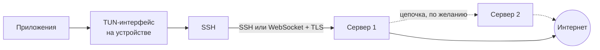

<p align="center">
  
</p>

<p align="center">
  <b>Перенаправляй трафик через свой SSH-сервер.</b><br>
  Твой сервер. Твой трафик. Никаких посредников.
</p>

---

## Что это

vzhukh — инструмент, который перенаправляет трафик устройства через твой
собственный SSH-сервер. Ставить на сервер ничего не нужно: если к нему можно
зайти по SSH, через него можно пустить трафик телефона, ноутбука или телевизора.

Это не сервис: нет подписок, аккаунтов и чужих серверов. Трафик выходит в
интернет там, где ты решил, и больше нигде.

- **Без серверной части.** Работает поверх `sshd`, который на сервере уже есть.
- **Свои правила.** Решай сам, какие приложения идут через туннель, а какие напрямую.
- **Доступ для своих.** Дай другу доступ к серверу и забери его, когда нужно.
- **Все устройства.** Телефон, телевизор и Mac с общими настройками.

## Как это работает



Устройство поднимает виртуальный сетевой интерфейс и забирает в него трафик.
TCP-соединения уходят в SSH-туннель и выходят в интернет с сервера, как будто
их открыл сам сервер. Ничего, кроме SSH, между устройством и сервером нет.

## Возможности

**Маршруты.** Маршрут — это один сервер или цепочка из нескольких. Трафик
проходит через каждый по очереди и выходит с последнего. Первый сервер видит
только, что ты подключаешься ко второму.

**Что идёт через туннель.** Можно отправить в туннель весь трафик или только
нужные приложения. На macOS правила работают ещё и по доменам: разные
приложения и сайты могут идти разными маршрутами, напрямую или блокироваться.

**Доступ для друзей.** Для каждого человека на сервере создаётся отдельный
пользователь со своим ключом и без доступа к shell. Приглашение передаётся
QR-кодом. Отзыв доступа удаляет этого пользователя, остальных он не задевает.

**Свои устройства.** Серверы, маршруты и правила передаются между твоими
устройствами по локальной сети или через QR-код, без облака.

**Телевизор.** Отдельный интерфейс для Android TV под пульт. Телефон
отправляет на телевизор маршрут и работает как пульт с тачпадом и клавиатурой.

**Устойчивость.** Туннель переподключается сам: при смене Wi-Fi на мобильную
сеть, после обрыва и после сна.

**Когда SSH заблокирован.** SSH можно пустить через WebSocket с TLS за обычным
веб-сервером. Для провайдера это выглядит как HTTPS.

## Платформы

| Платформа | Как устроен туннель |
| --- | --- |
| Android | Системный сервис туннеля, работает и при закрытом приложении |
| Android TV | То же, плюс интерфейс для пульта |
| macOS | Root-хелпер с собственным интерфейсом, правила по приложениям и доменам, просмотр трафика |
| iOS | NetworkExtension, для подписи нужен платный аккаунт Apple Developer |

## Что нужно от сервера

- **Любой Linux с SSH.** Хватит самого дешёвого VPS.
- **Пароль root** при добавлении сервера. Приложение один раз заходит под ним,
  заводит тебе отдельного пользователя с ключом и дальше подключается только
  этим ключом. Root снова понадобится, чтобы дать или забрать доступ у других.
- **WebSocket**, если SSH в сети блокируют. Пример настройки Caddy лежит в
  `example.Caddyfile`.
- **UDP через туннель** (QUIC, звонки) работает, если на сервере запущен
  `udpgw`. Ставится одной командой: `just udpgw-install user@host`.

## Безопасность

- Туннель открывается только по ключу Ed25519. Ключ создаётся на устройстве и
  хранится в системном защищённом хранилище.
- У каждого, включая тебя, свой пользователь на сервере без shell, а его ключу
  разрешён только проброс портов. Утёкший ключ не даёт управлять сервером.
- Пароль root нужен только для управления доступом, туннель им не пользуется.
- Приглашения шифруются паролем. QR-код и пароль передаются разными путями,
  и перехват одного из них ничего не даёт.
- Никакой телеметрии и внешних сервисов: приложение общается только с твоими
  серверами и твоими устройствами в локальной сети.

## Сборка

Нужны [FVM](https://fvm.app) с Flutter из проекта и [just](https://just.systems).
Для macOS-хелпера и правок в `go/` нужен ещё Go.

```sh
just apk-release && just install   # Android: собрать и поставить на устройство
just macos                         # macOS
just ios                           # iOS
just test                          # тесты
```

Остальные команды — в `just --list`. Устройство приложения описано в
`DESIGN.md`, macOS-хелпер — в
`docs/macos-daemon.md`.

## Вопросы

**Почему не WireGuard?**
SSH-сервер у тебя уже есть. WireGuard — это ещё один демон, ещё один открытый
порт и ещё одна настройка на каждом сервере. vzhukh не трогает сервер вообще.

**Это безопасно?**
Это SSH: тот же протокол, которым ты администрируешь сервер. Ключи создаются
на устройстве, а у каждого пользователя есть доступ только к туннелю.

**Почему «vzhukh»?**
Из мема про кота-волшебника: «вжух — и ты в интернете через свой сервер».
Кот на иконке — тот самый.

## Лицензия

[MIT](LICENSE)
