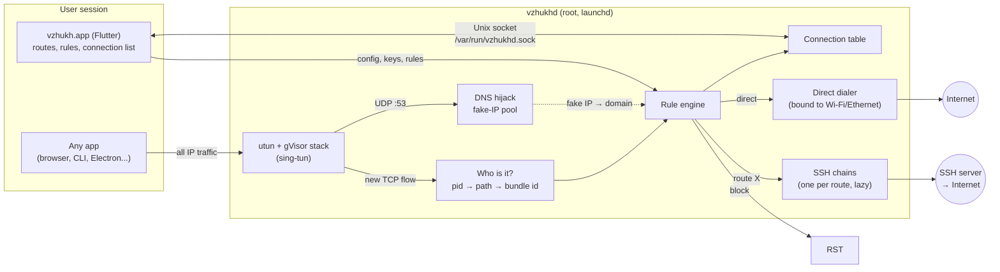

# macOS: one app instead of vzhukh + Proxifier + Proxyman

Status: phases 2a–2d are built and tested without root (Go: `just go-test`,
Dart: `just test`). Running it for real needs the helper installed; see
"Running it" at the end. Phase 1 (reconnect after sleep in the
Dart tunnel, `DESIGN.md` → Reconnect strategy) is done too.

## Goal

- Per-app and per-domain rules: through a route (SSH chain), direct, or
  blocked. Different rules may use different routes.
- DNS through the tunnel, so domain rules work and nothing leaks.
- A live connection list: which app, which host, which rule, which route,
  bytes, duration, errors. Metadata only: no TLS decryption.
- No paid Apple Developer account. That rules out NetworkExtension, which is
  what Proxifier uses (`NETransparentProxyProvider` + `NEDNSProxyProvider`).

## Shape

A root daemon, `vzhukhd`, owns a utun interface. Creating a utun needs root,
not an entitlement, so an ad-hoc signed binary is enough. The Flutter app
becomes a UI talking to the daemon over a Unix socket.

One flow, step by step:

1. An app connects to `example.com:443`. It resolves the name first; the query
   reaches the utun and is answered from the fake-IP pool (`198.18.0.0/16`):
   `example.com → 198.18.0.7`, TTL 1s.
2. The SYN to `198.18.0.7:443` enters the utun; gVisor terminates TCP.
3. The daemon finds the owning process from the flow's local port (sysctl
   `net.inet.tcp.pcblist_n`, the way sing-box does it), then its path
   (`proc_pidpath`) and bundle id (the enclosing `.app`'s `Info.plist`).
4. Rules are matched on (bundle id or path, domain, IP/CIDR, port), first
   match wins. Result: `route <id>`, `direct` or `block`.
5. `route`: `direct-tcpip` to `example.com:443` on that route's chain. The
   name is resolved by the server, not locally. `direct`: the daemon resolves
   locally and dials through the physical interface (`IP_BOUND_IF`), so the
   socket does not loop back into the utun.
6. The flow is added to the connection table and updated with bytes and
   close reason. The UI subscribes to it.

Apps that skip system DNS (DoH, hardcoded IPs) give a real IP and no domain.
For those, the first bytes of the stream are sniffed for a TLS SNI or an HTTP
`Host` header before the rule is matched.

## Components

### Go: `go/tun2socks`

Reused as is:
- `internal/sshtun`: chain dialing, keepalive, `Done()`. `BaseDialer` is
  already the hook for binding hop 1 to the physical interface.
- `internal/engine`: TUN → `Dialer`, via sing-tun/gVisor.

New:
- `cmd/vzhukhd`: daemon main, launchd lifecycle, IPC server.
- `internal/router`: rules, matching, actions. Pure and table-tested.
- `internal/procinfo` (darwin): local port → pid → path → bundle id, cached.
- `internal/fakedns`: pool, domain ↔ IP map, DNS answering.
- `internal/sniff`: TLS ClientHello SNI, HTTP Host.
- `internal/chains`: one chain per route, dialed on first use. Each chain is
  health-checked the same way phase 1 checks the Dart one: a keepalive with a
  reply timeout, wall-clock sleep detection, redial with backoff. The daemon
  also watches a `PF_ROUTE` socket for network changes.
- `internal/flows`: connection table (ring buffer) and subscriptions.
- Engine change: the `Dialer` is chosen per flow by the router, not fixed.

### IPC

- Unix socket `/var/run/vzhukhd.sock`, JSON messages, one per line.
- Auth: `LOCAL_PEERCRED`, so only the uid recorded at install may connect.
- Commands:
  - `status`
  - `apply{routes, rules}`
  - `start`
  - `stop`
  - `subscribe{status | flows}`
  - `version`
- Private keys come from the app on `apply` and stay in daemon memory only.
  The Keychain stays the app's.
- The daemon never runs or writes anything a client names: no paths, no
  commands. A compromised user process can change routing and read the
  connection list, and cannot get anything beyond that out of root.

### Install

- The daemon binary ships inside the app (`Contents/Resources/vzhukhd`).
- "Install helper" in the UI (or `just daemon-install`) runs, with
  administrator privileges:
  - copy the binary to `/Library/PrivilegedHelperTools/vzhukhd`, owned by
    root and not user-writable;
  - write `/Library/LaunchDaemons/dev.nogipx.vzhukh.daemon.plist`;
  - `launchctl bootstrap system ...`.
- It is never run from inside the app bundle: the user can write there, and
  replacing it would hand out root.
- The app compares `version` with the bundled binary and offers to update.
- Uninstall does the reverse.

### Flutter

- `lib/daemon/`: a `DaemonClient` over `dart:io` Unix sockets (no Swift
  needed), plus the use cases (`InstallDaemon`, `ApplyRouting`, ...).
- macOS `VpnController` path: `connect` sends `apply` + `start` and mirrors
  status from the daemon. The Dart SOCKS tunnel stays for Android.
- New screens: Rules, and Connections (live, filter by app, host, rule).
- macOS builds drop the App Sandbox: a sandboxed app cannot ask for admin
  rights or reach `/var/run`. The app is not in the App Store anyway.

## Phases

| Phase | Result | Replaces |
|---|---|---|
| 2a | Daemon + IPC + install; all traffic through one chain; reconnect inside the daemon | Proxifier for "everything through the tunnel" |
| 2b | Rule engine: app / CIDR / port → route, direct, block; several routes | Proxifier rules |
| 2c | Fake-IP DNS + SNI/Host sniffing; domain rules | Proxifier DNS through proxy |
| 2d | Connection table + Connections screen | Proxyman, at metadata level |

Each phase is usable on its own. 2a is the largest, because it carries the
install and privilege work.

## Out of scope for now

- UDP other than DNS: SSH has no UDP. It would need `udpgw` on the server.
  Until then UDP goes direct, or is blocked by a rule.
- HTTPS decryption (MITM with a local CA).
- iOS: per-app routing needs MDM there. iOS keeps its packet tunnel.

## Risks

- **Root daemon.** The IPC rules above are the security boundary. Keep the
  command set small and test the auth.
- **Other traffic interceptors.** Proxifier's transparent proxy takes flows
  at the socket layer, before routing ever reaches the utun. It has to be
  quit, not just paused. While running it even accepts connections to closed
  loopback ports, which phase 1's tests had to work around.
- **IPv6.** Route `::/0` into the utun as well, or block it. Otherwise v6
  traffic goes around every rule.
- **Fake-IP.** Some apps cache addresses past the TTL, so stopping the daemon
  can leave them with dead 198.18.x.x addresses for a moment. Exclude `.local`
  and LAN names.
- **Process lookup.** A flow that closes within a few milliseconds can be
  gone before the lookup; it falls back to the rules without an app. The
  `xinpcb_n` layout belongs to Apple and can change between macOS releases.
- **Ad-hoc signing.** macOS 13+ shows "Background item added" on install;
  that is expected.

## What was built

| Piece | Where |
|---|---|
| Daemon, IPC, platform | `go/tun2socks/cmd/vzhukhd`, `internal/daemon` |
| Rules | `internal/router` |
| Placeholder DNS | `internal/fakedns` |
| SNI / Host sniffing | `internal/sniff` |
| Socket → process | `internal/procinfo` (sysctl `pcblist_n`, verified on Darwin 24) |
| Routes, reconnect, sleep detection | `internal/chains` |
| Connection table | `internal/flows` |
| Terminal client | `cmd/vzhukhctl` (`just ctl status`) |
| App side | `lib/daemon`, `lib/vpn/macos_daemon_backend.dart`, `lib/ui/macos` |

Differences from the plan above:

- DNS settings are never changed. The daemon reads the system's resolvers
  (`scutil --dns`) and routes their addresses into the tunnel with /32 host
  routes, which beat any wider route another VPN has for them. Queries are
  answered by the daemon: placeholders for ordinary names, the system's
  resolver for names a rule leaves to the system. A first version set every
  service's DNS with `networksetup`; a corporate VPN client rewrites the same setting
  whenever it connects, and the two kept restoring their own copies over
  each other's. A backup left by that version is still restored at start.
- The tunnel lives in 198.19.0.0/30 and placeholders in 198.18.0.0/16. The
  first choice, 172.19.0.0/30, sat inside the 172.16.0.0/12 of a corporate VPN.
- Sockets past the tunnel are bound to an interface, chosen by the rule.
  Direct goes out of Wi-Fi or Ethernet only, never into another VPN, even
  one with a route for the address. A rule can name another VPN (action
  `vpn`): its connections are bound to that VPN's tunnel interface, its
  names get real answers from that VPN's resolvers, and while the VPN is
  down they are refused. A VPN is named by what owns its interface (the
  system's VPN service, or the process holding the utun open), since utun
  numbers change on every reconnect; `vzhukhctl vpns` lists them.
- The tunnel stands in front of other VPNs. For every route a VPN puts
  into its interface the tunnel gets the two halves of it, one bit more
  specific, so the VPN's traffic reaches the daemon first, shows in Traffic
  and follows the rules. What no rule decides goes back into the VPN whose
  network (/8 or narrower) or DNS domain it is, the way it went before.
  Host routes cannot be beaten and stay with the VPN: its gateway and own
  addresses. Pings follow the rules too: out of Wi-Fi, into a VPN, or
  refused when blocked. Traffic tab → menu → "In front of other VPNs" turns
  this off (`capture.leaveVpns`) for a VPN client that fights over its
  routes; then its networks never reach the daemon and go into it whatever
  the rules say.
- Direct rules of public addresses alone, with no apps and ports, are kept
  out of the tunnel by host routes, which is what another VPN's gateway
  needs. "Leave to macOS" rules (action `system`) are what rules said
  before a VPN could be named; the app turns them into `vpn` or `direct`
  once a connected VPN tells which was meant.
- The app polls; there are no subscriptions.
- `Config.capture` narrows the tunnel to some prefixes and can leave DNS
  alone, for moving off another tool gradually.
- Without the helper installed, macOS still falls back to the old SOCKS
  proxy on 127.0.0.1:2080.

## Running it

1. `just macos`, then start `build/macos/Build/Products/Release/vzhukh.app`.
2. Traffic tab → Install helper (administrator password).
3. Rules tab: add the rules; connect a route.
4. Traffic tab: every connection, with its app, domain, rule and route.

To remove the helper: Traffic tab → menu → Uninstall helper.

Proxifier and the daemon cannot run at the same time, and the daemon
refuses to start while Proxifier runs. Proxifier intercepts at the socket
layer, before routing, and with `ProcessServices` and
`HandleDirectConnections` on it takes the daemon's own SSH connection too.
For a "Direct" rule it opens the connection itself. Routing sends that into
the tunnel, the daemon dials it out, and Proxifier takes it again. Its loop
detection then ends it with "network is unreachable". The route never
connects, and Proxifier's own proxy usually needs the same server, so the
internet goes with it.

The servers a route connects to are kept out of the tunnel by host routes,
on top of binding the daemon's sockets to the physical interface.

## Waking from sleep

When the Mac wakes, macOS drops every route through Wi-Fi, the daemon's
included. Sockets bound to Wi-Fi then fail with "network is unreachable"
even though the routes look correct in the table. Repairing the routes
does not fix this; only a fresh tunnel does. So the daemon:

1. Notices the wake within a second. The wall clock jumps and the
   monotonic clock does not (`chains.watchClock`).
2. Restarts the tunnel in-process with the config and keys it holds
   (`Daemon.restart`), the same as reconnecting from the app.
3. Restarts again if a bound dial still finds no route. Within 90s of a
   wake the restarts can be 3s apart, because the first one often comes
   before Wi-Fi has joined.
4. Retries new chains every 0.5s at first instead of backing off.

Measured on this Mac: the route was up 1.5s after the wake. A second
restart about 4s later can briefly interrupt connections.

Outside of waking, `reassertRoutes` re-adds any of the daemon's routes
the system dropped. This is checked against the routing table itself,
because `route add` succeeds for routes that already exist.
